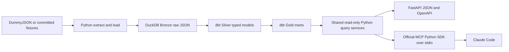

# Two-day MVP implementation plan

[SPEC.md](SPEC.md) defines the requirements and acceptance criteria. This plan records the approved MVP defaults and defines the implementation sequence and verification steps. Commands below are for the implementation phases and assume a PowerShell session at the repository root unless stated otherwise.

## Architecture and boundaries



Use Python 3.12, a compatible pinned set of DuckDB, dbt Core, dbt-duckdb, FastAPI, and the official `mcp` SDK. Lock direct and transitive dependencies for Windows and Linux. Prefer one lock with platform markers and hashes. If platform requirements differ, keep separate lock files and use the matching one in Windows development, each CI runner, and the Linux image. Prefer standard-library CLI and configuration, one HTTP client, parameterized SQL and typed response models. No ORM, task queue, extra LLM client, or cloud runtime is needed.

Use one absolute `WAREHOUSE_PATH` for readers and dbt within each environment. A refresh command creates a fresh candidate in the final warehouse directory, loads Bronze, closes the Python writer, runs dbt build against that candidate, checks the exit code and expected relations, and publishes with same-filesystem replacement after every writer has closed. A failed extract, build, or replacement leaves the last validated warehouse in service. Tests use their own temporary databases. Keep refreshes operator-serialized and stop FastAPI and the Claude MCP session before promotion, including any Docker readers of the same storage. Never run Python and dbt writers simultaneously on one file. FastAPI and MCP may read the published file concurrently with short-lived read-only connections scoped to each request or tool invocation. Test failed replacement and recovery on Windows and the Docker volume before relying on this workflow. [DuckDB concurrency](https://duckdb.org/docs/current/connect/concurrency), [Python DB API](https://duckdb.org/docs/clients/python/dbapi)

### Proposed repository structure

```text
SPEC.md
PLAN.md
AGENTS.md                      # Persistent project instructions for coding assistants
CLAUDE.md                      # Imports AGENTS.md for Claude Code
README.md
pyproject.toml
requirements.lock
.gitignore
.dockerignore
Dockerfile
ecommerce/                   # Installable Python package
  config.py                  # Absolute warehouse path and source settings
  extract.py                 # DummyJSON pagination and fixture ingress
  load.py                    # Bronze transaction
  refresh.py                 # Candidate lifecycle and dbt invocation
  queries.py                 # Fixed Gold queries and shared errors
  contracts.py               # Validated parameters and result models
  api.py                     # FastAPI handlers
  mcp_server.py              # Official SDK stdio entry point
analytics/
  dbt_project.yml
  profiles.yml               # Reads path from environment
  macros/                    # Exact layer schema names and reusable assertions
  models/staging/            # Bronze declarations and Silver models
  models/marts/              # Gold models and YAML model tests/docs
  tests/                     # Cross-model reconciliation checks
tests/
  fixtures/                  # Hand-authored paginated JSON and expected results
  test_extract.py
  test_load.py
  test_warehouse.py
  test_queries.py
  test_api.py
  test_mcp.py
docs/
  data-model.md
  demo.md
  cloud-portability.md
.github/workflows/ci.yml
data/                        # Generated warehouse and candidates, ignored
```

## Data and interface contracts

- **Bronze** uses `raw_products`, `raw_users`, and `raw_carts`, each with source ID, complete source JSON, and UTC ingestion timestamp. A refresh replaces all three in one transaction. Keep identical duplicates once and fail on conflicting payloads for the same ID. Idempotency compares keys, row counts, and payloads across repeated snapshots. The ingestion timestamp may advance. Fixtures inject a fixed clock.
- **Silver** uses typed staging views at product, user, and cart ID grain. Flatten cart items at (cart ID, source array ordinal), preserving legitimate repeated product lines. Deduplicate parent records before flattening, retain the source product and user keys, and expose only needed fields from users. Test cart-to-user, item-to-cart, and item-to-product relationships. Missing required fields, invalid types, orphans, and negative amounts, stock, or quantities fail validation.
- **Gold** uses tables for `cart_summary` (one row per cart, including empty carts), `product_performance` (one row per product with cart activity), `category_performance` (one row per category with cart activity), `customer_performance` (one row per customer with carts), `inventory_alerts` (one row per catalog product with stock), and `business_kpis` (one snapshot row). Query inventory independently of cart activity and apply the threshold in the shared service. Keep the KPI math in dbt. Declare Bronze with `source()`, chain models with `ref()`, and use Jinja for schema naming and shared assertions. dbt's default custom schema behavior prefixes the target schema, so explicitly verify exact `silver` and `gold` relation names against the query service. [dbt custom schemas](https://docs.getdbt.com/docs/build/custom-schemas)
- **Approved monetary defaults** use gross simulated cart-line value before discounts (cart-line unit price × quantity). Gross values reconcile across carts, products, categories, and customers. Use fixed decimal amounts, round reported values to two decimals, and serialize monetary values as decimal strings in both adapters. Omit the currency label until the source currency is verified. DummyJSON exposes both gross and discounted fields, so preserve both in raw records and document which basis the MVP applies. The catalog supplies category and stock at refresh time. Cart-line prices drive valuation. [DummyJSON carts](https://dummyjson.com/docs/carts)
- **KPI definitions** sum line values for total simulated cart value, count distinct snapshot cart IDs for number of carts, divide total value by cart count for average (null if there are zero carts), and sum line quantities for total quantity. Empty carts count and contribute zero. Empty datasets yield zero for total value, cart count, and quantity. Top products rank by summed value with product ID as tie breaker. Categories report summed value and quantity ordered by value then category. Customers rank by summed cart value with customer ID as tie breaker, with cart count included. Low stock means stock < threshold, sorted by stock then product ID, including zero stock when the threshold is positive. These are synthetic snapshot metrics. Avoid claims about sales, profit, conversion, or time periods.
- **Shared contracts** default top-list `limit` to 10 with range 1–100 and inventory `threshold` to 10 with range 0–10,000. Use the same defaults, argument validation, ordered results, and typed payloads for both adapters. Scope output to the documented metrics and public product fields. Customer results contain only source customer IDs and aggregate metrics. Use fixed, parameterized, schema-qualified Gold queries. Return empty lists for valid queries with no matches. Include snapshot timestamp and metric basis in analytical responses so the client can explain their scope.
- **REST** binds to loopback for local execution. `/health` checks warehouse readiness and responds with JSON 200 or 503. Analytics respond with JSON 200, 422 for invalid inputs, 503 for unavailable or uninitialized storage, or sanitized 500 for unexpected failures. Verify OpenAPI via `/openapi.json`. **MCP** exposes typed tool schemas and structured results, keeps stdout reserved for protocol traffic and sends diagnostics to stderr. Use bounded arguments, sanitized tool errors, and statically defined tools without SQL arguments. Pin one official SDK major version and follow its matching API and tests. [Official MCP Python SDK](https://py.sdk.modelcontextprotocol.io/), [structured output](https://py.sdk.modelcontextprotocol.io/v2/servers/structured-output/)

| REST GET path | MCP tool | Shared result |
| --- | --- | --- |
| `/health` | — | Warehouse readiness |
| `/api/v1/kpis` | `get_business_kpis` | Four snapshot KPIs |
| `/api/v1/products/top` | `get_top_products` | Ranked products by simulated cart value |
| `/api/v1/categories` | `get_category_performance` | Category value and quantity |
| `/api/v1/customers/top` | `get_top_customers` | Ranked customer IDs, cart value and count |
| `/api/v1/inventory/low-stock` | `get_low_stock_products` | Product IDs, titles and stock under threshold |

## Two-day implementation order

| Phase | Budget | Depends on | Deliverables and gate |
| --- | --- | --- | --- |
| 0. Agree contracts and check prerequisites | Day 1 · 1 h | SPEC.md | Approved defaults recorded, tool versions and platform lock checks recorded, fixture and response contracts defined |
| 1. Extract and load | Day 1 · 2 h | 0 | Python ingestion, fixture pages, Bronze tables, pagination and repeatability checks |
| 2. Transform and validate | Day 1 · 5 h | 1 | dbt model DAG and tests, verified metrics, end-to-end refresh with safe promotion |
| 3. Serve REST and MCP | Day 2 · 3 h | 2 | Shared queries, six routes and five tools, contract and protocol tests |
| 4. Package, validate and publish | Day 2 · 3 h | 3 | Image, persistent volume smoke test, CI and GHCR evidence |
| 5. Demonstrate and hand off | Day 2 · 2 h | 3–4 | Claude Code transcript, README and supporting docs, clean-room reproduction |

Start the Claude Code access and GHCR permission checks in phase 0. Run the Claude demo as soon as phase 3 passes while CI is running. The budget assumes tooling and account access are available. External verification gates remain open if access is unavailable.

### Phase 0 · Baseline and decisions

**FR-01–FR-12 and AC-01–AC-12 (planning).** Apply the approved defaults and check the outstanding account and publication gates. In the implementation turn, resolve and lock Python 3.12 dependencies. Install from the applicable lock in clean Windows and Linux environments, run `python -m pip check` and `dbt --version` on both, and run a DuckDB/dbt smoke build and FastAPI/MCP import checks. Select and pin the official SDK major before writing adapter imports. Record platform-specific markers or lock files and repeat these checks in CI. Check Docker Linux engine, GitHub branch and package policy, and Claude Code access. Plan a small hand-calculated fixture covering multiple pages, repeated IDs, tied rankings, empty carts, no-cart products, threshold boundaries, and distinct gross and discounted values.

```powershell
py -3.12 --version
docker version
claude --version
claude auth status
git remote -v
```

### Phase 1 · Extract and load

**FR-01, FR-02, FR-09 → AC-01, AC-02, AC-09.** Implement explicit positive `limit` and advancing `skip` for each list endpoint. Validate page metadata and payload keys, fail on stalled pagination or inconsistent counts, use bounded timeouts and retry transient network errors, HTTP 429 and 5xx with a bounded backoff, and fail clearly on permanent errors. Use the same record validation for fixtures and live data. Compute one UTC timestamp per refresh. Stage all records before replacing Bronze tables together. Test paginated HTTP with mocked responses, timeout exhaustion, permanent errors, malformed pages, duplicate handling, repeat-load equivalence, removed source IDs, and rollback after a failed insert. DummyJSON documentation defines the paging parameters for all three resources. [Products](https://dummyjson.com/docs/products), [users](https://dummyjson.com/docs/users), [carts](https://dummyjson.com/docs/carts)

```powershell
$py = (Resolve-Path .\.venv\Scripts\python.exe).Path
& $py -m pytest -q tests/test_extract.py tests/test_load.py
```

Gate on stable Bronze keys, counts and payloads after two loads of identical fixtures and an intact prior snapshot after injected failure.

### Phase 2 · Model, reconcile and publish a validated snapshot

**FR-03, FR-04, FR-05, FR-09 → AC-03, AC-04, AC-05, AC-09.** Implement sources, Silver and Gold in dependency order. Add dbt generic key, required-field and relationship tests, plus SQL assertions for non-negative values, unique item grain and roll-up reconciliation. Check that cart and item aggregates agree with KPI and customer totals, and that categories and products account for the same line values. Do not assume source discounts or rounding match the derived values. Use pytest to assert hand-computed expected metrics independently and demonstrate a failing dbt run with an orphan or negative value. Build against the candidate, publish only after successful validation, and test that the previous warehouse remains readable after validation or promotion failure. Commit metadata and model/column documentation as part of implementation. Generate dbt documentation against a disposable fixture warehouse with readers stopped.

```powershell
$env:WAREHOUSE_PATH = Join-Path (Get-Location).Path 'data/warehouse.duckdb'
& $py -m ecommerce.refresh --fixture-dir tests/fixtures
& $py -m pytest -q tests/test_warehouse.py
# Direct dbt verification against a separate fixture warehouse built by the refresh command.
$env:WAREHOUSE_PATH = Join-Path (Get-Location).Path 'data/dbt-check.duckdb'
& $py -m ecommerce.refresh --fixture-dir tests/fixtures
& .\.venv\Scripts\dbt.exe build --project-dir analytics --profiles-dir analytics
& .\.venv\Scripts\dbt.exe docs generate --project-dir analytics --profiles-dir analytics
$env:WAREHOUSE_PATH = Join-Path (Get-Location).Path 'data/warehouse.duckdb'
```

Gate on named Bronze, Silver and Gold relations, passing validation, matching expected metrics, and generated lineage. Run one separate live smoke refresh with `& $py -m ecommerce.refresh --live` using a separate warehouse path. Record extraction counts, successful validation and any upstream inconsistencies as AC-01 evidence. Keep live refresh out of CI.

### Phase 3 · Shared query services, REST and MCP

**FR-05, FR-06, FR-07, FR-09 → AC-05, AC-06, AC-07, AC-09.** Implement and test fixed Gold queries first, then wire FastAPI and official SDK stdio handlers. Verify database read-only behavior, input boundaries, deterministic ordering, unsupported tool handling, and missing-file or lock errors. Run the MCP SDK client against a child stdio process to test initialization, discovery of all five tools, schemas and valid/invalid calls. Assert REST/MCP parity against the same fixture file, allowlisted customer fields, and concurrent cross-process reads.

```powershell
& $py -m pytest -q tests/test_queries.py tests/test_api.py tests/test_mcp.py
# Terminal A
& $py -m uvicorn ecommerce.api:app --host 127.0.0.1 --port 8000
# Terminal B
Invoke-RestMethod http://127.0.0.1:8000/health
Invoke-RestMethod http://127.0.0.1:8000/api/v1/kpis
Invoke-RestMethod http://127.0.0.1:8000/openapi.json
```

Gate on the expected contract for every route and tool, including failure responses. Keep the fixture warehouse available for the subsequent Claude demo.

### Phase 4 · Docker and GitHub Actions

**FR-09, FR-10, FR-11 → AC-09, AC-10, AC-11.** Package Python 3.12, pinned dependencies, dbt project and synthetic seed fixtures in one Linux image. Start FastAPI with `python -m uvicorn ecommerce.api:app --host 0.0.0.0 --port 8000` inside Docker. Publish host port 8000 on `127.0.0.1` only. Enable explicit refresh and stdio MCP through command overrides. Use a writable named volume for initialization and mount it read-only while serving. Align the image runtime user with volume ownership and test from a fresh volume. Keep host port publication on loopback. Exclude generated warehouses, virtual environments and credentials from the image context. Pin the base image digest and CI actions to reviewed versions.

```powershell
& $py -m pytest -q
docker build --tag ecommerce-mvp:local .
docker volume create ecommerce-mvp
docker run --rm --mount source=ecommerce-mvp,target=/data --env WAREHOUSE_PATH=/data/warehouse.duckdb ecommerce-mvp:local python -m ecommerce.refresh --fixture-dir tests/fixtures
docker run --detach --name ecommerce-api --publish 127.0.0.1:8000:8000 --mount source=ecommerce-mvp,target=/data,readonly --env WAREHOUSE_PATH=/data/warehouse.duckdb ecommerce-mvp:local
Invoke-RestMethod http://127.0.0.1:8000/health
Invoke-RestMethod http://127.0.0.1:8000/api/v1/kpis
docker rm -f ecommerce-api
```

Repeat the serving command with the same named volume and verify the fixture KPIs without reinitializing. Stop any local listener on port 8000 before starting the container.

Run CI on pull requests and pushes to main. Use Windows PowerShell and Ubuntu runners for Python/dbt checks. Install from the matching committed lock on both, run `python -m pip check` and `dbt --version`, and use the verified Linux lock for the image. Initialize fixtures, run pytest and a visible dbt build on a disposable warehouse, and build and smoke-test the Linux image. Enable publication only after explicit owner approval of repository visibility, GHCR namespace, package visibility and publication. After a separately authorized push to main passes validation, publish the same validated image artifact under a commit-SHA tag in the lowercase GHCR namespace. Scope package write permissions and `GITHUB_TOKEN` login to the main-only publish job. Use read-only repository permissions for validation jobs. Acceptance evidence is a green workflow for the commit and a recorded GHCR digest verified by pulling the SHA tag with the intended access. [GitHub publishing workflow](https://docs.github.com/en/actions/tutorials/publish-packages/publish-docker-images)

```powershell
# Optional workflow checks with GitHub CLI after an authorized main push
gh run list --branch main --workflow ci.yml --limit 3
gh run view RUN_ID --exit-status
# Verify the published image with Docker and the intended package access.
docker pull ghcr.io/owner/repo:COMMIT_SHA
docker image inspect ghcr.io/owner/repo:COMMIT_SHA --format '{{json .RepoDigests}}'
```

Without GitHub CLI, open the repository's **Actions** tab, select the workflow run for the main commit, and inspect the validation and publication jobs for the image tag and digest. Open the package in GitHub's **Packages** view to confirm its visibility and SHA-tagged version. Use the same Docker pull and digest check above to verify access.

### Phase 5 · Claude demo and reproduction

**FR-08, FR-12 → AC-08, AC-12.** Register the local stdio server using the absolute interpreter and fixture warehouse path, with environment settings in local scope. Validate that stdout carries only the MCP protocol and that working-directory changes do not break startup. Use Claude Code with the existing Claude subscription only. Do not provision an additional paid API or a project-managed LLM API key. [Claude Code stdio registration](https://code.claude.com/docs/en/mcp), [Claude Code authentication](https://code.claude.com/docs/en/legal-and-compliance)

```powershell
$env:WAREHOUSE_PATH = Join-Path (Get-Location).Path 'data/warehouse.duckdb'
claude mcp add --transport stdio --scope local --env "WAREHOUSE_PATH=$env:WAREHOUSE_PATH" ecommerce -- "$py" -m ecommerce.mcp_server
claude mcp list
claude
```

In Claude Code inspect `/mcp`, confirm tool discovery, and ask for snapshot KPIs, top products and low-stock alerts. Compare tool calls, arguments, and answers to fixture expectations. Ask for last month's completed revenue and confirm the answer explains that the snapshot cannot support the metric. Capture a sanitized transcript with tool calls and returned data. SDK protocol tests provide AC-07 evidence. AC-08 requires the actual Claude session.

Write all project documentation in English. The README covers prerequisites, clean checkout setup via Python 3.12 and PowerShell, local/fixture/live initialization, dbt docs, REST examples, Claude registration, Docker and GHCR, limitations, and the architecture diagram. Data model docs specify model grains, keys, quality rules and metric definitions. Describe BigQuery, Snowflake, Databricks and Fabric as migration options, covering adapter choice and compatibility, JSON flattening and SQL dialect changes, storage and landing pattern, service identity, orchestration and deployment. Run the README steps in a fresh Windows checkout with a clean virtual environment and new warehouse path. Capture successful refresh, pytest, dbt build, API/MCP use and container checks.

## Acceptance evidence

| Criterion | Requirement and phase | Exit evidence |
| --- | --- | --- |
| AC-01 | FR-01/02 · 1–2 | Fixture and manual live refresh land all three source collections in Bronze |
| AC-02 | FR-02/09 · 1 | Second identical load has identical logical rows and no duplicate keys |
| AC-03 | FR-03/04 · 2 | Fixture-backed dbt build exits successfully |
| AC-04 | FR-02/03 · 2 | Catalog checks find all named Bronze, Silver and Gold relations |
| AC-05 | FR-04/05 · 2–3 | Independent expected values match all KPI and mart results, including edge cases |
| AC-06 | FR-06/09 · 3 | All six routes return documented JSON with correct values and statuses |
| AC-07 | FR-07/09 · 3 | SDK subprocess discovers and calls five tools with schema, privacy and error assertions |
| AC-08 | FR-08 · 5 | Claude Code session uses tools, grounds answers in fixture results and handles unsupported questions |
| AC-09 | FR-04/09/11 · 1–4 | Unit, API, integration, dbt, idempotency and MCP tests pass offline |
| AC-10 | FR-10 · 4 | Linux image builds, serves fixture KPIs and reuses its volume after recreation |
| AC-11 | FR-11 · 4 | Main workflow publishes validated SHA-tagged image and a pull confirms digest |
| AC-12 | FR-12 · 5 | Another developer follows the README in a clean Windows checkout |

## Non-functional requirements

| SPEC.md requirement | Implementation and evidence |
| --- | --- |
| Maintainability and modularity | One extract/load path, SQL-owned metric definitions and two thin delivery adapters. Review the model DAG and shared contract tests. |
| Reproducibility | Python 3.12, pinned dependencies and base image, deterministic fixtures and documented setup. Run Windows and Linux checks. |
| Idempotency and data integrity | Transactional Bronze load, validated snapshot promotion, deterministic deduplication and dbt tests. Exercise reruns, failed builds and failed promotion. |
| Secure, controlled access | Local-only REST binding, MCP stdio, fixed parameterized queries and minimized result fields. Keep raw user JSON local and out of logs, Git, demo output and container images. |
| Clear error handling | Actionable CLI stderr and nonzero exit, sanitized REST statuses and SDK tool errors. Inject upstream, locking and schema failures. |
| Version control and spec-driven development | During implementation, review each completed increment against requirement IDs, record decisions, update docs and commit verified changes only with explicit approval. Push only with explicit approval. Amend SPEC.md only through a later approved requirement change. |
| No paid external APIs or cloud services | Run locally with synthetic data, use deterministic synthetic fixtures for automated validation, and run the separate manual live DummyJSON smoke test. Use the existing Claude subscription and the available GitHub tier for delivery. |
| Windows local development | Use PowerShell, explicit interpreter paths, absolute warehouse paths and tests of spaces, locks and process shutdown. Verify native Windows separately from Linux containers. |

## Risks and unresolved decisions

| Priority | Risk or missing requirement | Proposed mitigation or approval |
| --- | --- | --- |
| High | Gross vs discounted valuation, currency and rounding are unspecified. | Apply the approved gross, pre-discount valuation and two-decimal amounts. Document the arithmetic in metric definitions and fixtures. Keep the currency label absent until verified. |
| High | The source endpoints are independently paginated and may drift or provide orphan references. | Validate page counts and references, fail the live refresh on conflict and keep the previous validated warehouse. Owner approves any later quarantine or relaxed integrity policy. |
| High | DuckDB locks, Windows file replacement, Docker volume ownership and leftover handles can break refresh. | Build in a separate candidate, close writers and readers before promotion, test replacement/restart, and document a maintenance window. Stopping readers for publication is approved. Concurrent serving during promotion needs a different design. |
| High | Claude Code account eligibility may conflict with the no-paid-services constraint, and client trust can block tool discovery or calls. | Verify the existing Claude subscription can run the demo and that Claude Code permits the local server. Mark AC-08 pending if that access is unavailable. Treat unsupported-metric behavior as a demonstrated case rather than a guarantee across prompts. |
| High | GHCR publishing depends on repository, Actions, token and package permissions. The spec permits container delivery but excludes production deployment. | Obtain explicit owner approval for repository visibility, GHCR namespace, package visibility and publication. Obtain explicit authorization before pushing to main. Confirm usage fits the available tier. Publish an image only. Keep AC-11 pending until an actual push and digest check succeed. |
| Medium | Ranking, empty results, freshness and response shapes need contract verification. | Use the approved strict stock threshold with a configurable default of 10. Verify contract edge cases across REST and MCP. Document snapshot freshness as manual batch refresh cadence. No throughput, maximum volume or latency targets are specified. Scope validation to the DummyJSON dataset and record observed local behavior. |
| Medium | Bronze raw preservation and least-privilege tool output can be conflated. | Preserve full source objects in local Bronze. Keep the reader interface restricted to approved Gold projections, and treat filesystem access to the warehouse as trusted local access. Customer results and demo evidence may contain customer IDs and aggregate metrics only. |
| Medium | SDK major/API drift and dbt naming or path divergence can break adapters at runtime. | Verify locked dependency compatibility from clean Python 3.12 installations on Windows and Linux. Verify stdio end-to-end and assert exact relations and path resolution before serving. |

## Scope and completion

**Mandatory MVP** includes batch ingestion, transactional full refresh, Bronze/Silver/Gold dbt lineage and docs, quality checks, all eight analytics, all REST routes and MCP tools, a Claude Code demo, deterministic tests, persistent Docker execution, GHCR delivery and reproducible documentation. Cloud portability documentation is mandatory.

**Optional after all gates** includes incremental dbt models, scheduled ingestion, a dashboard and an actual cloud warehouse migration. Streaming, production infrastructure, production auth, distributed processing, production orchestration, historical tracking, LLM training and production deployment are outside MVP scope.

Before signing off implementation, review code and SQL against the traced requirements, confirm error paths and documentation, record acceptance evidence, and obtain explicit approval before any commit or push. Track missing external evidence against its acceptance ID and owner.

## Phase 7 · Integrated AI Business Assistant

Phase 7 follows the optional React dashboard increment and leaves the published MVP unchanged. Runtime scope is native localhost.

| Order | Requirements and acceptance | Deliverable and verification |
| --- | --- | --- |
| 1 | FR-14 · AC-14 | Review the interrupted dependency change, validate the hash lock and add backend-only settings and ignored SQLite usage storage. Verify configuration, pricing tiers, atomic reservations and rate limits with pytest. |
| 2 | FR-13/14 · AC-13/14 | Discover the five existing MCP stdio tools using the packaged interpreter and canonical warehouse path. Validate tool arguments and results, replay tool and thinking blocks, and reserve each bounded Messages call. Exercise fixture responses through a real local MCP session with the Messages transport mocked. |
| 3 | FR-14/15 · AC-14/15 | Add localhost chat routes and an accessible React assistant inside the existing dashboard shell. Test existing analytics, compile TypeScript and verify disabled, pending, success and error states in Edge. |
| 4 | FR-15 · AC-15/16 | Document assumptions and remaining checks. Run the full local verification suite. Record live access as pending separate owner approval. Production Docker and hosted CI/CD updates belong to a later phase. |

Verification uses a unique project-local pytest base directory with the cache provider disabled on Windows. Run the existing frontend typecheck, test and build commands. A clean fixture refresh covers dbt and feeds native MCP. No automated tests use Anthropic credentials or call its servers.

## Phase 8 · Production full-stack Docker

1. **FR-16 → AC-17.** Pin the frontend build image. Install via the frontend lock, typecheck, build, and copy only `dist` into the Python runtime. Add explicit static routes, preserving native operation and the API route contract. Verify with pytest, frontend commands and a local image build.
2. **FR-17 → AC-18/19.** Add localhost-only Compose serving and explicit maintenance, dedicated bridge checks and separate named volumes. Preserve the budget ledger on restart and replacement. Check fixture refresh, mount modes, non-root permissions, ledger persistence, default-disabled chat, trusted-origin rejection and build-context exclusions.
3. **FR-16/17 → AC-17/18/19.** Verify the compiled dashboard in Edge on one origin. Run the complete Python suite with the provider mocked, including inside Docker with networking disabled. Document runtime-only AI configuration and non-overwriting ledger migration. Defer workflow edits, publication and cloud deployment.
