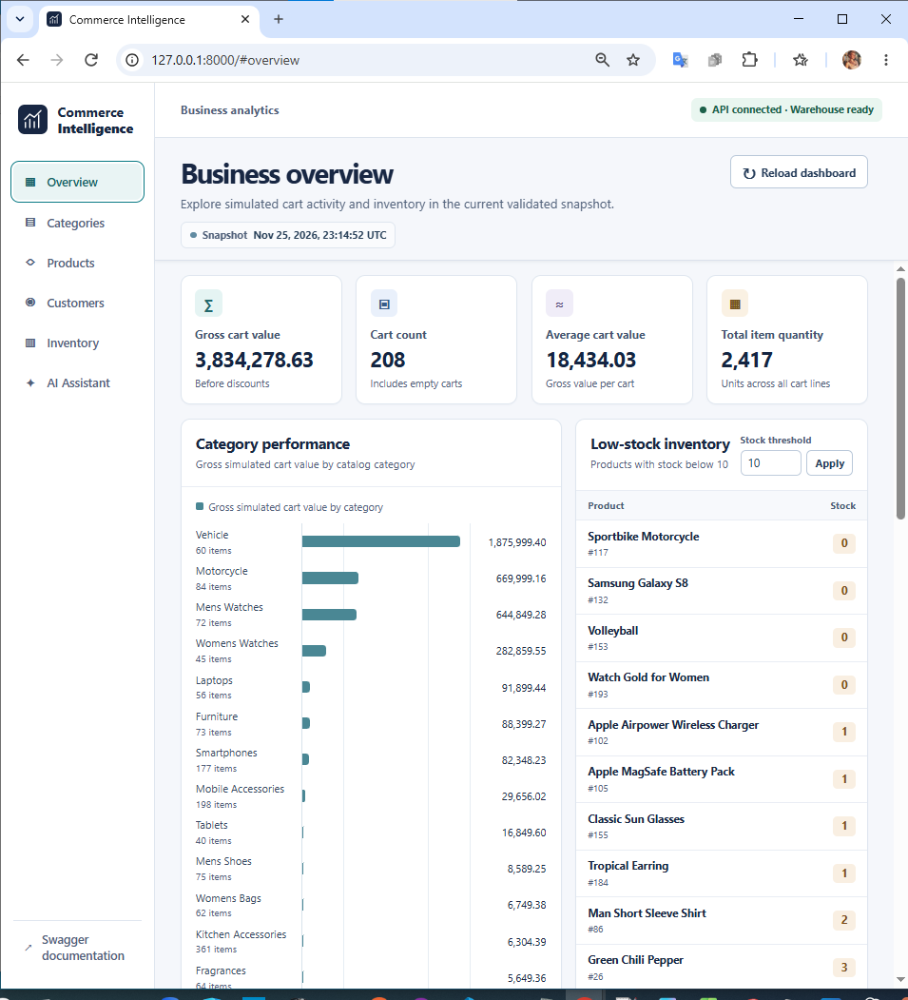
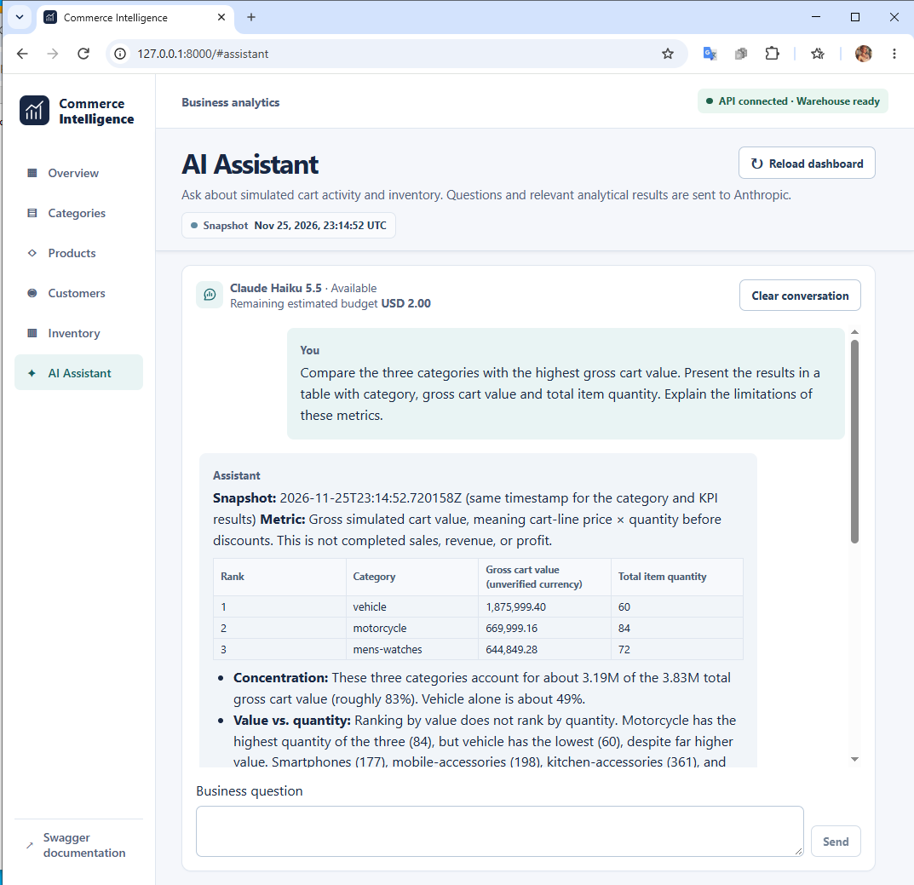

# Intelligent E-Commerce Data Platform

**Commerce Intelligence** is a local retail analytics dashboard for exploring simulated shopping carts and inventory. It answers three practical questions: what contributes most to cart value, which customers account for the most cart activity, and which products are below a chosen stock threshold?

The project takes data from ingestion through quality checks and a published analytical snapshot. Analysts can use the dashboard, query the API, or ask an optional assistant backed by the same analytical tools. Cart activity is synthetic and measures pre-discount cart value. Completed sales, revenue, and confirmed demand are outside this dataset.

**Project highlights**

- Validated snapshot refresh with rollback protection and reproducible dbt tests.
- Interactive product, category, customer, and inventory analysis with shareable dashboard links.
- Read-only REST and MCP tools with an optional assistant and a persistent application spending ledger.
- One localhost Docker image and a CI pipeline that publishes only an explicitly approved, tested image.

[Docker quick start](#docker) · [Native development](#native-development-on-windows) · [Screenshot gallery](docs/screenshots/README.md) · [Verification evidence](PROGRESS.md)

## Dashboard preview

**Business overview**



The overview brings the validated cart snapshot and inventory alerts into one view.

**AI Assistant**



The assistant compares the top three categories and explains the metric behind the ranking.

[View the full gallery and publication review notes](docs/screenshots/README.md)

## Architecture

```mermaid
flowchart LR
    Source["DummyJSON API or synthetic fixtures"] --> Extract["Python extraction and transactional load"]
    subgraph Candidate["Candidate DuckDB file"]
        Bronze["Bronze · raw JSON tables"] --> Silver["Silver · typed dbt views"]
        Silver --> Gold["Gold · dbt analytical tables"]
    end
    Extract --> Bronze
    Gold --> Gate{"dbt tests and relation checks"}
    Gate -->|"Pass · replace file"| Published["Published DuckDB snapshot"]
    Gate -->|"Fail · discard candidate"| Previous["Previous snapshot stays available"]
    Published --> Queries["Shared read-only Python queries"]
    Queries --> REST["FastAPI · JSON and Swagger"]
    Queries --> MCP["MCP server · stdio"]
    MCP --> Claude["Claude Code"]
    REST --> Dashboard["React dashboard"]
    Dashboard --> Chat["FastAPI chat · optional"]
    Chat --> Ledger["SQLite usage ledger"]
    Chat <-->|"bounded Messages calls"| Provider["Anthropic · Claude Haiku 5.5"]
    Chat -->|"official MCP client"| MCP
```



| Layer | Implementation |
| --- | --- |
| Bronze | Three tables preserve source IDs, raw JSON, and an ingestion timestamp. Paginated extraction retries transient errors. The transactional load deduplicates identical records and rejects conflicting IDs. |
| Silver | Four typed views validate source keys and relationships. Cart items retain their zero-based source position, including repeated product lines. |
| Gold | Six tables serve cart, product, category, customer, inventory, and snapshot analytics. Gross simulated cart value uses pre-discount cart-line price × quantity. |

The refresh command builds a separate candidate, runs `dbt build`, checks the expected relation names and types, and closes its handles before replacing the active file. Data tests check required fields, uniqueness, references, numeric ranges, and reconciliation across the marts. The API and MCP server share typed contracts and fixed, parameterized Gold queries. Customers are exposed by ID and aggregate metrics. [Detailed data model](docs/data-model.md)

**Stack.** React, TypeScript, Vite, Python 3.12, HTTPX, DuckDB, dbt Core and dbt-duckdb, FastAPI, Pydantic, official MCP and Anthropic Python SDKs, SQLite, pytest, Docker Compose, GitHub Actions, and GHCR.

## Native development on Windows

From the repository root in PowerShell, using Python 3.12:

```powershell
if (-not (Test-Path .\.venv\Scripts\python.exe)) { py -3.12 -m venv .venv }
$py = (Resolve-Path .\.venv\Scripts\python.exe).Path
& $py -m pip install --require-hashes --only-binary=:all: -r requirements.lock
& $py -m pip install --no-deps -e .
& $py -m pip check

$env:WAREHOUSE_PATH = Join-Path (Get-Location).Path 'data/warehouse.duckdb'
& $py -m ecommerce.refresh --fixture-dir tests/fixtures
if ($LASTEXITCODE) { throw 'Fixture refresh failed' }
& $py -m ecommerce.api
```

Open [Swagger UI](http://127.0.0.1:8000/docs) or [OpenAPI JSON](http://127.0.0.1:8000/openapi.json). Fixture KPIs are **20.00 gross simulated cart value**, **3 carts**, **6.67 average cart value**, and **3 items**.

In a second PowerShell terminal, use Node 22.16.0 and start the Vite development proxy.

```powershell
Set-Location frontend
npm ci
npm run dev
```

Open [the native dashboard](http://127.0.0.1:5173). The analytics sections support direct links such as `/#categories`, and the assistant is at `/#assistant`.

Use the same absolute `WAREHOUSE_PATH` for refresh and serving. To test the live source, assign a different path such as `data/live-smoke.duckdb` and run `& $py -m ecommerce.refresh --live`. Live raw source data stays in the local warehouse. Stop readers and writers before replacing any published warehouse and run one refresh at a time.

## REST and MCP

| REST GET endpoint | MCP tool | Result |
| --- | --- | --- |
| `/health` | — | Warehouse readiness |
| `/api/v1/kpis` | `get_business_kpis` | Snapshot KPIs |
| `/api/v1/products/top?limit=5` | `get_top_products` | Ranked products |
| `/api/v1/categories` | `get_category_performance` | Category values and quantities |
| `/api/v1/customers/top?limit=5` | `get_top_customers` | Ranked customer IDs and aggregates |
| `/api/v1/inventory/low-stock?threshold=10` | `get_low_stock_products` | Inventory strictly below the threshold |

The assistant uses `GET /api/v1/chat/status` for availability and `POST /api/v1/chat` for local chat requests.

From a second terminal:

```powershell
$base = 'http://127.0.0.1:8000'
Invoke-RestMethod "$base/api/v1/kpis"
Invoke-RestMethod "$base/api/v1/products/top?limit=1" | ConvertTo-Json -Depth 5
Invoke-RestMethod "$base/api/v1/inventory/low-stock?threshold=10" | ConvertTo-Json -Depth 5
```

Ranked lists accept 1–100 rows and default to 10. The inventory threshold accepts 0–10,000 and defaults to 10. Empty matches return `items: []`. Responses carry the snapshot time and metric basis. Amounts use two-decimal strings. Invalid arguments return 422, unavailable warehouses return 503, and unexpected failures return a sanitized 500.

Claude Code launches the stdio server independently of FastAPI. With the validated fixture warehouse and the existing Claude subscription:

```powershell
$py = (Resolve-Path .\.venv\Scripts\python.exe).Path
$env:WAREHOUSE_PATH = (Resolve-Path .\data\warehouse.duckdb).Path
claude auth status
claude mcp add --env "WAREHOUSE_PATH=$env:WAREHOUSE_PATH" --transport stdio --scope local ecommerce -- "$py" -m ecommerce.mcp_server
claude mcp list
claude
```

Open `/mcp` in Claude Code and ask for the current simulated cart KPIs. The server also runs directly as `& $py -m ecommerce.mcp_server` when an MCP client manages stdin and stdout. [Verified demo scenarios](docs/demo.md)

## Docker

Use Docker Desktop in Linux container mode or Docker Engine 28 or newer with Compose. The build pins Node 22.16.0 and Python 3.12 by digest. Node builds the dashboard, then the Python runtime serves the compiled files and API on one origin. The runtime uses UID/GID 10001 and hash-locked Python dependencies.

```powershell
docker compose --env-file .env.example build app
docker compose --env-file .env.example run --rm --no-deps refresh
docker compose --env-file .env.example up --detach app

$base = 'http://127.0.0.1:8000'
Start-Process $base
Invoke-RestMethod "$base/health"
Invoke-RestMethod "$base/api/v1/kpis"
Invoke-RestMethod "$base/api/v1/chat/status"
(Invoke-WebRequest "$base/docs" -UseBasicParsing).StatusCode
```

Stop any native FastAPI process on port 8000 before starting Docker. The published host port binds only to `127.0.0.1`. Use that address for containerized chat. Compose places the app on a dedicated bridge and the chat routes verify its gateway, host, and browser origin. Keep this service local and the bridge dedicated to this application. If `172.30.80.0/24` conflicts with a local network, set `ECOMMERCE_SUBNET` to an unused private subnet and `ECOMMERCE_GATEWAY` to its gateway address. [Docker port binding](https://docs.docker.com/engine/network/port-publishing/)

The warehouse volume is writable only for maintenance. The separate usage volume stays writable while serving. Both named volumes survive stop, restart, replacement and `down`. Keep the same Compose project name and avoid `down --volumes`. Stop all readers before refresh.

```powershell
docker compose --env-file .env.example stop app
docker compose --env-file .env.example run --rm --no-deps refresh
docker compose --env-file .env.example up --detach app
docker compose --env-file .env.example restart app
# Stop and remove the service container while preserving both volumes.
docker compose --env-file .env.example down
```

Use the default fixture refresh for fast, repeatable tests. For demonstrations, explicitly refresh the full synthetic DummyJSON dataset over the network. Run the following in the same Compose project and stop all warehouse readers first.

```powershell
docker compose --env-file .env.example stop app
docker compose --env-file .env.example run --rm --no-deps refresh python -m ecommerce.refresh --live
if ($LASTEXITCODE) { throw 'DummyJSON refresh failed' }
docker compose --env-file .env.example up --detach app
```

The owner-observed Docker snapshot contained 208 carts and 2,417 items, with gross simulated value **3,834,278.63** and average value **18,434.03**. Later refreshes reflect the source at the time they run. [Observed results](PROGRESS.md#phase-10--release-corrections-and-portfolio)

### Optional AI at runtime

Compose defaults to AI disabled with no key. Use `--env-file .env.example` for the documented baseline to avoid automatically loading a local `.env`. To enable the assistant, first [migrate any native usage ledger](docs/ai-assistant.md#migrate-the-native-usage-ledger) while both apps are stopped. Use a dedicated PowerShell terminal for the masked prompt. Docker administrators can inspect runtime environment variables.

```powershell
$key = Read-Host 'Anthropic API key' -AsSecureString
try {
    $env:ANTHROPIC_API_KEY = [System.Net.NetworkCredential]::new('', $key).Password
    $env:AI_ENABLED = 'true'
    docker compose --env-file .env.example up --detach --force-recreate --no-build app
} finally {
    Remove-Item Env:ANTHROPIC_API_KEY -ErrorAction SilentlyContinue
    Remove-Item Env:AI_ENABLED -ErrorAction SilentlyContinue
    $key.Dispose()
}
```

To return to disabled mode, clear any AI overrides, then recreate the service with the example file. A regular restart retains the existing container configuration. Recreating the same service keeps both named volumes. [Runtime settings and ledger migration](docs/ai-assistant.md)

## Verification and CI/CD

The original backend MVP was published to GHCR. All four full-stack validation jobs passed on PR #1, and publication was skipped. See [current and historical verification evidence](PROGRESS.md) for precise test counts and release status.

Local Phase 10 checks passed 77 Python tests on Windows and Linux, 11 frontend tests, TypeScript and the production build, workflow lint, and fixture Docker smoke tests. Edge verified all six dashboard routes in both native development and compiled modes.

| Check | Observed result |
| --- | --- |
| Full Python suite | 66 passed on Windows and 66 passed in the Linux x86-64 image with networking disabled |
| dbt build | 93 passes, including 83 data tests, with zero warnings, errors, or skips |
| Live DummyJSON refresh | 194 products, 208 users, and 208 carts published after validation |
| REST and MCP | Six endpoints and five stdio tools verified, with matching fixture results |
| Claude Code | Single-tool and autonomous multi-tool execution demonstrated. An unsupported historical sales request was rejected. |
| Container | Non-root startup, health, Swagger, fixture metrics, read-only storage, persistence across recreation, and image save/load verified |

To run the full suite on Windows with a unique project-local temporary directory:

```powershell
$testTmp = Join-Path (Resolve-Path .\.venv).Path ("pytest-" + [guid]::NewGuid())
& $py -m pytest -q --basetemp $testTmp -p no:cacheprovider
```

To repeat the image checks:

```powershell
docker compose --env-file .env.example build app
docker run --rm --network none --tmpfs /tmp:rw,nosuid,nodev,mode=1777 ecommerce-fullstack:local python -m pytest -q --basetemp /tmp/pytest-ecommerce -p no:cacheprovider
& .\scripts\Test-FullStack.ps1 -Image ecommerce-fullstack:local -CleanupVolumes
# If needed, add -Port 18080 and -SubnetPrefix 172.29.90 to isolate the test.
```

### Full-stack workflow

[GitHub Actions](.github/workflows/ci.yml) validates pull requests and pushes to `main`.

1. The Windows/Ubuntu Python 3.12 matrix verifies the hash lock, runs `pip check`, loads fixtures, and runs dbt and pytest. The separate Ubuntu frontend job uses Node 22.16.0, `npm ci`, typechecking, tests, and a production build. Its npm download cache is keyed by `frontend/package-lock.json`.
2. After both jobs succeed, the container job builds and labels the image once, runs pytest with container networking disabled, and runs the Compose smoke test on that same image. The smoke test uses `.env.example` and a new project with temporary synthetic volumes. Cleanup runs after failures. Fixtures and usage are written to temporary volumes and are excluded from artifacts.
3. Passing main pushes save the tested image archive, checksum, and image ID for three days. Publication requires an exact match between `GHCR_APPROVED_SHA` and the main push SHA. The publish job checks the checksum, loads the artifact, and verifies the image ID and source revision label before pushing the same image to the lowercase repository path. Only this job has package write permission.

The smoke test verifies default-disabled Compose startup and recreates the app with dummy settings to check runtime propagation and volume persistence. Enabled request tests mock the Anthropic transport, so CI needs no API key or credits.

### Owner-approved release

1. Push the reviewed feature branch and open a PR. Confirm the Python, frontend and production image jobs pass.
2. Obtain approval for the exact main commit and package destination. If repository rules allow an owner to push the merge, fetch main and create the reviewed merge locally. Set the Actions repository variable to the resulting full SHA **before** pushing main. Use **Settings → Secrets and variables → Actions → Variables**, or the GitHub CLI command below. A different merge or squash SHA requires a fresh approval.

```powershell
# Owner only, after review and authorization. Use a clean working tree.
git fetch origin
git switch main
git pull --ff-only origin main
git merge --no-ff feature/ai-assistant
$releaseSha = (git rev-parse HEAD).Trim()
gh variable set GHCR_APPROVED_SHA --repo OWNER/REPO --body $releaseSha
git push origin main
```

3. Open the main push run in **Actions** and confirm it used the approved SHA. Check the published digest in the publish job summary and independently pull the SHA tag. If branch rules require GitHub to create the merge, verify the actual main SHA after merging and use the rerun controls for that exact main push after recording approval. Confirm that the rerun evaluates the gate and finishes before treating it as a release. Private pulls require registry authentication with package read access. [GitHub workflow reruns](https://docs.github.com/en/actions/managing-workflow-runs/re-running-workflows-and-jobs)

```powershell
$env:ECOMMERCE_IMAGE = 'ghcr.io/owner/repo:COMMIT_SHA'
docker pull $env:ECOMMERCE_IMAGE
docker image inspect --format '{{json .RepoDigests}}' $env:ECOMMERCE_IMAGE
# Initialize once in an isolated release project. This replaces that project's warehouse.
docker compose --project-name ecommerce-release --env-file .env.example run --rm --no-deps --pull never refresh
docker compose --project-name ecommerce-release --env-file .env.example up --detach --no-build --pull never app
Start-Process 'http://127.0.0.1:8000'
# When finished, stop the service and retain both volumes.
docker compose --project-name ecommerce-release --env-file .env.example down
Remove-Item Env:ECOMMERCE_IMAGE
```

Keep port 8000 free and stop other instances of the Compose stack before starting the release project. On subsequent runs, skip initialization to retain the existing snapshot.

## Known limitations

- The project analyzes one synthetic cart snapshot. It has no completed sales events, historical trend data, or verified currency.
- Refresh is a manual batch operation against a single local DuckDB file. Readers must close before publication.
- REST is intended for local use and has no production authentication. MCP exposes predefined tools over local stdio.
- Claude Code's phrasing and tool selection can vary. Tool results and the metric definitions are the reference for interpreting answers.
- Independent clean-checkout reproduction remains open.
- Internet-facing deployment is future work. It would require authenticated access, TLS, managed secrets, durable metering across replicas, and a fresh review of data access and isolation. The existing localhost package is intended for local use.

## Optional React dashboard

[Commerce Intelligence](frontend/README.md) provides a local browser interface for the existing REST metrics, including category performance, independent ranking filters, and a low-stock threshold. During development, Vite runs at `127.0.0.1:5173` and proxies requests to native FastAPI. The full-stack Docker image serves everything from `127.0.0.1:8000` without Vite.

[Data model and metric definitions](docs/data-model.md) · [Claude Code demo](docs/demo.md) · [Cloud portability](docs/cloud-portability.md) · [Specification](SPEC.md) · [Implementation plan](PLAN.md) · [Progress and acceptance](PROGRESS.md)

## How the optional assistant works

FastAPI validates the local request and conversation bounds. The agent discovers the five allowlisted tools through the MCP Python client and reserves estimated spend in SQLite before each Claude Haiku 5.5 call. It validates tool requests, reads the Gold snapshot through MCP, and returns tool evidence, snapshot metadata, and estimated token cost with the answer. The frontend renders Markdown with HTML, links, and remote images disabled.

The default application budget is USD 2.00, with up to five tool rounds, six model calls per request, and five chat requests per minute. Uncertain calls retain their reservation, and SDK retries are disabled. The API key stays in the backend at runtime. The local ledger estimates spend and preserves it across container replacement. Billing and provider-side limits are managed separately. [Assistant architecture and accounting](docs/ai-assistant.md)
