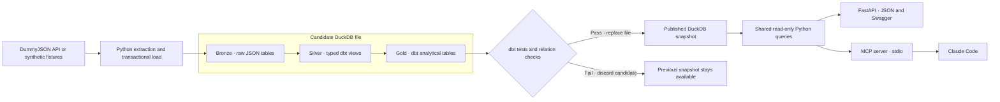

# Intelligent E-Commerce Data Platform

A local analytics platform that turns synthetic DummyJSON shopping carts into a validated DuckDB snapshot. A retail analyst can use REST or ask Claude Code to compare products and categories, rank customers by simulated cart value, and find products below a stock threshold.

**Backend MVP verified on Windows and Linux and published to GHCR.** [Acceptance status](PROGRESS.md)

## Architecture



| Layer | Implementation |
| --- | --- |
| Bronze | Three tables preserve source IDs, raw JSON, and an ingestion timestamp. Paginated extraction retries transient errors. The transactional load deduplicates identical records and rejects conflicting IDs. |
| Silver | Four typed views validate source keys and relationships. Cart items retain their zero-based source position, including repeated product lines. |
| Gold | Six tables serve cart, product, category, customer, inventory, and snapshot analytics. Gross simulated cart value uses pre-discount cart-line price × quantity. |

The refresh command builds a separate candidate, runs `dbt build`, checks the expected relation names and types, and closes its handles before replacing the active file. Data tests check required fields, uniqueness, references, numeric ranges, and reconciliation across the marts. The API and MCP server share typed contracts and fixed, parameterized Gold queries. Customers are exposed by ID and aggregate metrics. [Detailed data model](docs/data-model.md)

**Stack:** Python 3.12, HTTPX, DuckDB, dbt Core and dbt-duckdb, FastAPI and Pydantic, official MCP Python SDK 2.3.0, Claude Code, pytest, Docker, GitHub Actions, and GHCR.

## Quick start on Windows

From the repository root in PowerShell, using Python 3.12:

```powershell
if (-not (Test-Path .\.venv\Scripts\python.exe)) { py -3.12 -m venv .venv }
$py = (Resolve-Path .\.venv\Scripts\python.exe).Path
& $py -m pip install --require-hashes --only-binary=:all: -r requirements.lock
& $py -m pip install --no-deps -e .
& $py -m pip check

$env:WAREHOUSE_PATH = Join-Path (Get-Location).Path 'data/warehouse.duckdb'
& $py -m ecommerce.refresh --fixture-dir tests/fixtures
if ($LASTEXITCODE) { throw 'Fixture refresh failed' }
& $py -m ecommerce.api
```

Open [Swagger UI](http://127.0.0.1:8000/docs) or [OpenAPI JSON](http://127.0.0.1:8000/openapi.json). Fixture KPIs are **20.00 gross simulated cart value**, **3 carts**, **6.67 average cart value**, and **3 items**.

Use the same absolute `WAREHOUSE_PATH` for refresh and serving. To test the live source, assign a different path such as `data/live-smoke.duckdb` and run `& $py -m ecommerce.refresh --live`. Live raw source data stays in the local warehouse. Stop readers and writers before replacing any published warehouse and run one refresh at a time.

## REST and MCP

| REST GET endpoint | MCP tool | Result |
| --- | --- | --- |
| `/health` | — | Warehouse readiness |
| `/api/v1/kpis` | `get_business_kpis` | Snapshot KPIs |
| `/api/v1/products/top?limit=5` | `get_top_products` | Ranked products |
| `/api/v1/categories` | `get_category_performance` | Category values and quantities |
| `/api/v1/customers/top?limit=5` | `get_top_customers` | Ranked customer IDs and aggregates |
| `/api/v1/inventory/low-stock?threshold=10` | `get_low_stock_products` | Inventory strictly below the threshold |

From a second terminal:

```powershell
$base = 'http://127.0.0.1:8000'
Invoke-RestMethod "$base/api/v1/kpis"
Invoke-RestMethod "$base/api/v1/products/top?limit=1" | ConvertTo-Json -Depth 5
Invoke-RestMethod "$base/api/v1/inventory/low-stock?threshold=10" | ConvertTo-Json -Depth 5
```

Ranked lists accept 1–100 rows and default to 10. The inventory threshold accepts 0–10,000 and defaults to 10. Empty matches return `items: []`. Responses carry the snapshot time and metric basis. Amounts use two-decimal strings. Invalid arguments return 422, unavailable warehouses return 503, and unexpected failures return a sanitized 500.

Claude Code launches the stdio server independently of FastAPI. With the validated fixture warehouse and the existing Claude subscription:

```powershell
$py = (Resolve-Path .\.venv\Scripts\python.exe).Path
$env:WAREHOUSE_PATH = (Resolve-Path .\data\warehouse.duckdb).Path
claude auth status
claude mcp add --env "WAREHOUSE_PATH=$env:WAREHOUSE_PATH" --transport stdio --scope local ecommerce -- "$py" -m ecommerce.mcp_server
claude mcp list
claude
```

Open `/mcp` in Claude Code and ask for the current simulated cart KPIs. The server also runs directly as `& $py -m ecommerce.mcp_server` when an MCP client manages stdin and stdout. [Verified demo scenarios](docs/demo.md)

## Docker

Use Docker Desktop in Linux container mode or Docker Engine 28 or newer with Compose. The build pins Node 22.16.0 and Python 3.12 by digest. Node builds the dashboard, then the Python runtime serves the compiled files and API on one origin. The runtime uses UID/GID 10001 and hash-locked Python dependencies.

```powershell
docker compose --env-file .env.example build app
docker compose --env-file .env.example run --rm --no-deps refresh
docker compose --env-file .env.example up --detach app

$base = 'http://127.0.0.1:8000'
Start-Process $base
Invoke-RestMethod "$base/health"
Invoke-RestMethod "$base/api/v1/kpis"
Invoke-RestMethod "$base/api/v1/chat/status"
(Invoke-WebRequest "$base/docs" -UseBasicParsing).StatusCode
```

Stop any native FastAPI process on port 8000 before starting Docker. The published host port binds only to `127.0.0.1`. Use that address for containerized chat. Compose places the app on a dedicated bridge and the chat routes verify its gateway, host, and browser origin. Keep this service local and the bridge dedicated to this application. If `172.30.80.0/24` conflicts with a local network, choose an unused private subnet and update both the gateway and trusted peer in `compose.yaml`. [Docker port binding](https://docs.docker.com/engine/network/port-publishing/)

The warehouse volume is writable only for maintenance. The separate usage volume stays writable while serving. Both named volumes survive stop, restart, replacement and `down`. Keep the same Compose project name and avoid `down --volumes`. Stop all readers before refresh.

```powershell
docker compose --env-file .env.example stop app
docker compose --env-file .env.example run --rm --no-deps refresh
docker compose --env-file .env.example up --detach app
docker compose --env-file .env.example restart app
# Stop and remove the service container while preserving both volumes.
docker compose --env-file .env.example down
```

Fixture refresh is a separate, explicit operation. The existing live refresh and MCP stdio commands remain available. Run `python -m ecommerce.refresh --live` as a command override for the maintenance service only when intentionally refreshing from DummyJSON.

### Optional AI at runtime

The standard Compose service runs with AI disabled. To explicitly start the same app with AI enabled, first [migrate any native usage ledger](docs/ai-assistant.md#migrate-the-native-usage-ledger) while both apps are stopped. Then supply the key through a masked prompt in PowerShell. The Docker daemon and users with Docker administrative access can inspect runtime environment variables.

```powershell
docker compose --env-file .env.example stop app
$key = Read-Host 'Anthropic API key' -AsSecureString
try {
    $env:ANTHROPIC_API_KEY = [System.Net.NetworkCredential]::new('', $key).Password
    docker compose --env-file .env.example run --detach --no-deps --service-ports --name ecommerce-ai-local --env AI_ENABLED=true --env ANTHROPIC_API_KEY app
} finally {
    Remove-Item Env:ANTHROPIC_API_KEY -ErrorAction SilentlyContinue
    $key.Dispose()
}
```

Use `docker stop ecommerce-ai-local` and `docker start ecommerce-ai-local` to restart that configured container. To return to disabled mode, stop and remove `ecommerce-ai-local`, then start the standard Compose service. Keep the usage volume across mode changes. Additional non-secret limits can be passed with `--env` as described in the [local assistant guide](docs/ai-assistant.md).

## Verification and CI/CD

| Check | Observed result |
| --- | --- |
| Full Python suite | 66 passed on Windows and 66 passed in the Linux x86-64 image with networking disabled |
| dbt build | 93 passes, including 83 data tests, with zero warnings, errors, or skips |
| Live DummyJSON refresh | 194 products, 208 users, and 208 carts published after validation |
| REST and MCP | Six endpoints and five stdio tools verified, with matching fixture results |
| Claude Code | Single-tool and autonomous multi-tool execution demonstrated. An unsupported historical sales request was rejected. |
| Container | Non-root startup, health, Swagger, fixture metrics, read-only storage, persistence across recreation, and image save/load verified |

To run the full suite on Windows with a unique project-local temporary directory:

```powershell
$testTmp = Join-Path (Resolve-Path .\.venv).Path ("pytest-" + [guid]::NewGuid())
& $py -m pytest -q --basetemp $testTmp -p no:cacheprovider
```

To repeat the image checks:

```powershell
& .\scripts\Test-DockerImage.ps1 -Image ecommerce-mvp:local
docker run --rm --network none ecommerce-mvp:local python -m pytest -q --basetemp /tmp/pytest-ecommerce -p no:cacheprovider
```

[GitHub Actions](.github/workflows/ci.yml) is configured for pull requests and pushes to `main`. A Windows/Ubuntu matrix installs from the lock and runs fixture-backed dbt and pytest. A separate Ubuntu job builds and smoke-tests the image. On a main push, the publish job requires all checks and an owner-approved commit SHA. It reloads the tested image, verifies its image ID, and uses a job-scoped `GITHUB_TOKEN` to publish to the lowercase GHCR repository path with the commit SHA tag.

For an approved destination and reviewed commit, set the repository Actions variable `GHCR_APPROVED_SHA` to the exact commit before the authorized main push. Use the GitHub web UI or `gh variable set GHCR_APPROVED_SHA --repo OWNER/REPO --body COMMIT_SHA`. After the workflow succeeds, compare the digest in the publish job summary with the pull result. Private pulls require registry authentication with package read access. [Publication checklist and open acceptance criteria](PROGRESS.md)

```powershell
$image = 'ghcr.io/owner/repo:COMMIT_SHA'
docker pull $image
docker image inspect --format '{{json .RepoDigests}}' $image
```

## Known limitations

- The project analyzes one synthetic cart snapshot. It has no completed sales events, historical trend data, or verified currency.
- Refresh is a manual batch operation against a single local DuckDB file. Readers must close before publication.
- REST is intended for local use and has no production authentication. MCP exposes predefined tools over local stdio.
- Claude Code's phrasing and tool selection can vary. Tool results and the metric definitions are the reference for interpreting answers.
- Independent clean-checkout reproduction remains open.

## Optional React dashboard

[Commerce Intelligence](frontend/README.md) provides a local browser interface for the existing REST metrics, including category performance, independent ranking filters, and a low-stock threshold. During development, Vite runs at `127.0.0.1:5173` and proxies requests to native FastAPI. The full-stack Docker image serves everything from `127.0.0.1:8000` without Vite.

[Data model and metric definitions](docs/data-model.md) · [Claude Code demo](docs/demo.md) · [Cloud portability](docs/cloud-portability.md) · [Specification](SPEC.md) · [Implementation plan](PLAN.md) · [Progress and acceptance](PROGRESS.md)

## Optional local AI Assistant

The dashboard's **AI Assistant** sends questions, bounded chat context and selected synthetic analytical results to Anthropic. Its agent uses Claude Haiku 5.5 and the same five MCP tools as the Claude Code demo. Read the [local assistant setup, cost controls and verification](docs/ai-assistant.md).
